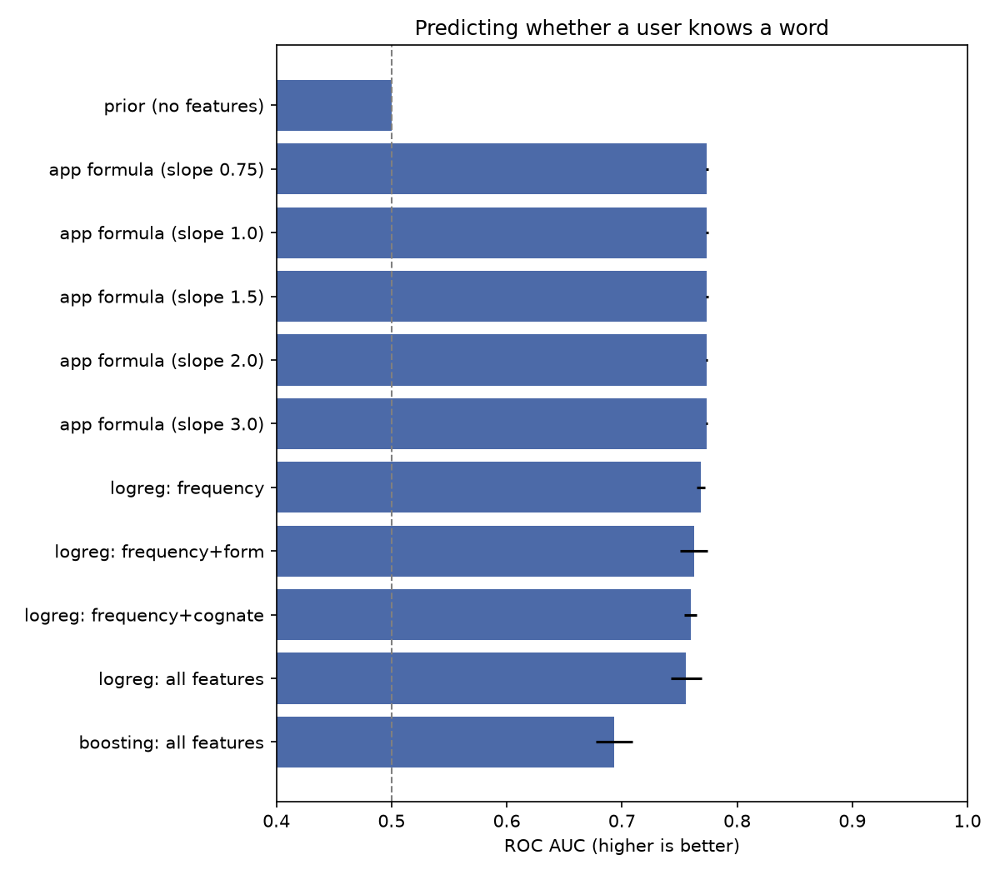
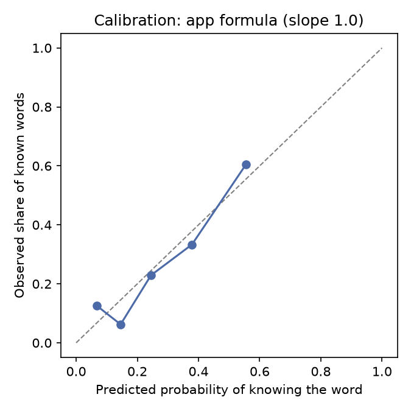

# SubLingo

**English summary.** SubLingo is an Android app (Kotlin, Jetpack Compose) with a FastAPI backend that turns the subtitles of a film or series episode into a personal study plan. It extracts the words of the episode, estimates which ones the user probably does not know, reports how much of the episode they already understand, and trains the missing words with cloze exercises and spaced repetition. The word-knowledge model is fitted on the user's own answers; the ML section below describes the data, the models compared, the results and the limitations.

---

## Что это

Хочется смотреть сериал в оригинале, но мешают незнакомые слова. SubLingo берёт субтитры серии (файл `.srt`), находит в них слова и выражения, которые вы, скорее всего, не знаете, считает, какую долю серии вы уже понимаете, и помогает выучить недостающие слова упражнениями.

Как это выглядит для пользователя:

1. Вы загружаете `.srt` серии или фильма.
2. Проходите короткий тест уровня (30 слов, «знаю / не знаю»).
3. Получаете отчёт: «Вы понимаете примерно 94%. Чтобы понимать 95%, выучите N слов» и список слов с примерами из серии.
4. Тренируете слова: предложение с пропуском, четыре варианта ответа, повторения по расписанию.

<!-- TODO: добавьте скриншоты: список серий, отчёт, тест уровня, упражнение -->

## Как это работает

```
.srt  →  очистка  →  spaCy (леммы, части речи)  →  список слов + частотность (wordfreq)
                                                          │
 ответы теста  →  личный порог пользователя  →  вероятность знания каждого слова
                                                          │
                          покрытие серии  +  слова для изучения  +  упражнения  +  повторения
```

- **Разбор текста.** Субтитры очищаются от тегов, ремарок и имён говорящих. Библиотека spaCy определяет части речи и приводит слова к начальной форме (`went` → `go`). Имена, служебные и очень частотные слова отбрасываются, находятся фразовые глаголы.
- **Модель знания слов.** Вероятность, что человек знает слово, считается по его частотности в языке: `p = 1 / (1 + exp(-s · (zipf − t)))`. Личный порог `t` подбирается по ответам теста (максимальное правдоподобие с мягким априором), наклон `s` выбран по кросс-валидации.
- **Покрытие.** `1 − (ожидаемые незнакомые вхождения / все слова серии)`. Цель по умолчанию 95%.
- **Упражнения и повторения.** Предложение с пропуском берётся из самой серии. Расписание повторений построено по упрощённому алгоритму SM-2.

## Технологии

| Часть | Стек |
|---|---|
| Мобильное приложение | Kotlin, Jetpack Compose, Navigation, ViewModel, Retrofit, kotlinx.serialization, DataStore |
| Сервер | Python 3.12, FastAPI, SQLAlchemy 2, Alembic, JWT-авторизация (Argon2) |
| База данных | PostgreSQL 16 (Docker) |
| NLP | spaCy (`en_core_web_sm`), wordfreq |
| ML и анализ | scikit-learn, pandas, matplotlib |
| Тесты | pytest (бэкенд и ML-функции) |

## Структура репозитория

```
sublingo/
├── app/                  Android-приложение (Kotlin, Jetpack Compose)
├── backend/
│   ├── app/nlp/          очистка .srt, анализ spaCy, модель знания слов
│   ├── app/ml/           выгрузка датасета, признаки, сравнение моделей
│   ├── app/routers/      REST-эндпоинты
│   ├── app/services/     упражнения, интервальные повторения
│   ├── migrations/       миграции Alembic
│   └── tests/
├── ml/
│   ├── labels/           размеченный вручную список слов для проверки признака когнатности
│   └── results/          таблицы метрик и графики
├── docs/                 описание MVP, схемы
└── docker-compose.yml    PostgreSQL
```

## Запуск (Windows, PowerShell)

Нужны: Docker Desktop, [uv](https://docs.astral.sh/uv/), Android Studio.

```powershell
git clone https://github.com/SAYNEX32/sublingo
cd sublingo

# 1. База данных
copy .env.example .env      # затем задайте пароль и SECRET_KEY в .env
docker compose up -d db

# 2. Сервер
cd backend
uv sync
uv run alembic upgrade head
uv run uvicorn app.main:app --reload
```

Документация API: http://localhost:8000/docs

**Android:** откройте папку `app` в Android Studio, дождитесь синхронизации Gradle и запустите на эмуляторе. Эмулятор обращается к серверу по адресу `http://10.0.2.2:8000` (адрес задан в `ApiConfig`).

Первая загрузка серии занимает больше времени: загружается языковая модель spaCy.

**Тесты:**

```powershell
cd backend
uv run pytest
```

## Основные эндпоинты

| Метод | Путь | Назначение |
|---|---|---|
| POST | `/auth/register`, `/auth/login` | регистрация и вход |
| GET | `/auth/me` | текущий пользователь |
| POST | `/episodes/analyze` | загрузка `.srt` и анализ серии |
| GET | `/episodes`, `/episodes/{id}/words` | серии и слова серии |
| GET | `/episodes/{id}/report` | покрытие и слова для изучения |
| GET, POST | `/placement/words`, `/placement/submit` | тест уровня |
| PUT, GET | `/words/mark`, `/words/mine` | отметки «знаю / учу» |
| GET, POST | `/exercises/next`, `/exercises/{id}/answer` | упражнения и повторения |

---

## ML: результаты и ограничения

### Задача

По слову предсказать вероятность того, что конкретный пользователь его знает. Эта вероятность используется в отчёте (оценка покрытия серии) и при выборе слов для упражнений.

### Данные

- Источник: ответы «знаю / не знаю» из теста уровня. Слова теста выбираются поровну из семи диапазонов частотности, повторно одно и то же слово пользователю не предлагается.
- Объём: **240 ответов по 238 словам**, около 27% «знаю».
- В выгрузке два аккаунта, но принадлежат они **одному человеку**, поэтому все выводы относятся к одному пользователю.
- Ответы упражнений в обучении не используются: слова для них выбирает сама система, а ответ с выбором из четырёх вариантов можно угадать.

### Признаки

| Набор | Содержимое |
|---|---|
| frequency | частотность слова по шкале Zipf (wordfreq) |
| form | длина слова, число слогов, часть речи |
| cognate | похожесть на русское слово (описание ниже) |

**Признак «когнатность».** Английское слово транслитерируется в кириллицу в нескольких вариантах, латинские окончания заменяются русскими (`-tion` → `-ция`, `-ist` → `-ист`), и в русском словаре частот ищется самое частотное совпадение. Отдельно признак проверен на списке из 146 слов (82 когната), размеченном вручную автором проекта (`ml/labels/cognates.csv`): AUC 0,80; при пороге 3,0 находится около 65% когнатов и 20% слов без русского двойника отмечается ошибочно.

### Методика оценки

Повторная (20 раз) 5-кратная кросс-валидация, разбиение по словам, чтобы слово не попадало одновременно в обучение и проверку. Метрики: ROC AUC (качество порядка слов), log-loss и Brier (качество вероятностей). Доверительные интервалы разницы между моделями получены бутстрепом по словам (1000 повторов). Код: `backend/app/ml/compare_models.py`, подробные результаты: `ml/results/metrics.md`.

### Результаты

| Модель | AUC | Log-loss | Brier |
|---|---|---|---|
| Базовая линия (всегда 27%) | 0,500 | 0,584 | 0,197 |
| Формула приложения, наклон 3,0 (исходная) | 0,774 | 0,620 | 0,172 |
| Формула приложения, наклон 2,0 | 0,774 | 0,527 | 0,162 |
| Формула приложения, наклон 1,5 | 0,774 | 0,498 | 0,158 |
| **Формула приложения, наклон 1,0 (выбрана)** | **0,774** | **0,491** | **0,159** |
| Формула приложения, наклон 0,75 | 0,774 | 0,499 | 0,162 |
| Логистическая регрессия: частотность | 0,769 | 0,497 | 0,159 |
| Логистическая регрессия: частотность + форма | 0,762 | 0,500 | 0,163 |
| Логистическая регрессия: частотность + когнатность | 0,760 | 0,504 | 0,162 |
| Логистическая регрессия: все признаки | 0,756 | 0,507 | 0,165 |
| Градиентный бустинг: все признаки | 0,693 | 0,611 | 0,198 |





### Выводы

1. **Частотность даёт почти всё качество.** Простая формула с одним личным параметром не хуже логистической регрессии.
2. **Дополнительные признаки не помогли.** Форма слова и когнатность не улучшили предсказания на этих данных. Для когнатности разница относительно одной частотности около −0,008 AUC (интервал от −0,012 до −0,005), то есть улучшения нет. Для формы слова интервал включает ноль, различие не подтверждено.
3. **Сложная модель проиграла.** Градиентный бустинг заметно хуже (разница около −0,065 AUC, интервал от −0,110 до −0,016): 240 примеров недостаточно, модель переобучается.
4. **Найденная и исправленная ошибка калибровки.** Исходная формула с наклоном 3,0 хорошо упорядочивала слова (AUC 0,774), но давала слишком уверенные вероятности: её log-loss (0,620) оказался хуже базовой линии (0,584). Наклон подобран перебором с кросс-валидацией, лучшим стал 1,0 (log-loss 0,491). Урок: AUC не замечает проблемы с вероятностями, а в приложении покрытие считается именно по вероятностям.

### Ограничения

- **Один человек.** Данные принадлежат одному пользователю, обобщать результаты на других нельзя. Личный порог подбирается индивидуально, но проверка признаков на нескольких людях не проводилась.
- **Самооценка.** Метка «знаю» основана на ответе человека без проверки; возможны ошибки и завышение.
- **Небольшая выборка.** Разница около 0,01 AUC между близкими моделями находится в пределах шума.
- **Наклон выбран по тем же данным**, на которых оценивался (параметр один, но оценка слегка оптимистична).
- **Список когнатов размечен автором проекта.** Разметка могла содержать ошибки и субъективные решения.
- **Покрытие приблизительное.** Слова, не попавшие в список кандидатов (служебные, очень частотные, имена), считаются известными, поэтому у новичка реальное покрытие ниже.
- **Предобученная модель spaCy** (`en_core_web_sm`) ошибается в частях речи и леммах (например, `mechanics` → `mechanic`).
- **Нет языковой модели (LLM).** Упражнения строятся по предложениям из серии; генерация упражнений языковой моделью не реализована.

### Что дальше

- Собрать ответы нескольких людей и повторить сравнение: только так можно проверить признак когнатности.
- Добавить слова-ловушки (несуществующие слова) в тест, чтобы оценивать завышение знаний.
- Проверять отдельную калибровку для каждого пользователя.
- Подбирать параметры повторений по реальным ответам вместо фиксированных значений.

## Данные и лицензии

- Файлы субтитров (`*.srt`) в репозиторий не добавляются (см. `.gitignore`): они защищены авторским правом. Приложение хранит только слова, их частотность и по одному короткому примеру предложения (до 300 символов), а не субтитры целиком.
- Выгрузки данных пользователей (`ml/data/`) также исключены из репозитория.
- Лицензия: <!-- TODO: выберите лицензию, например MIT, и добавьте файл LICENSE -->.
